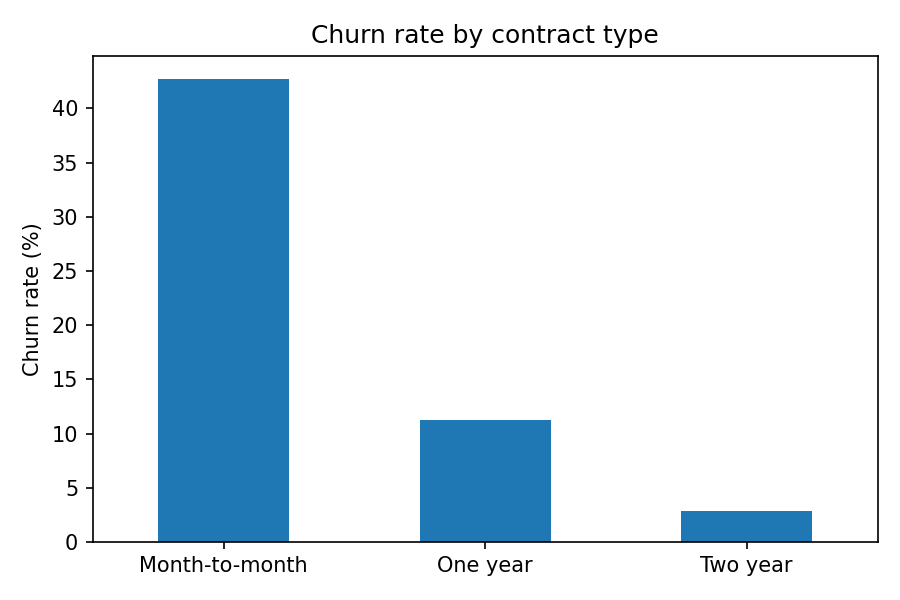

# Telecom Customer Churn Prediction

[](https://colab.research.google.com/github/SaismithSahoo/churn-project/blob/main/notebooks/churn_analysis.ipynb)


## Problem

A telecom company wants to identify customers who are likely to cancel, so the retention team can contact them before they leave. Missing a customer who is about to leave costs more than wrongly flagging a loyal one, so I prioritized **recall** (catching as many churners as possible) while keeping an eye on precision so the team isn't flooded with false alarms.

## Data

Telco Customer Churn (IBM sample dataset, available on Kaggle): 7,043 customers, 20 features, 26.5% churn rate.

Because the data is imbalanced, accuracy is misleading: a model that always predicts "no churn" scores 73% accuracy but catches 0% of churners. I judged models on recall, precision and ROC-AUC instead.

## Approach

1. **Cleaning:** 11 customers had a blank `TotalCharges`. All were brand-new (tenure = 0, not yet billed), so I filled the blanks with 0. I merged "No internet service" and "No phone service" into "No", since that information is already in `InternetService` and `PhoneService`.
2. **EDA:** compared churn rates across categories and looked at tenure and monthly charges for churners vs. non-churners.
3. **Preparation:** one-hot encoded the categorical columns and made a stratified 80/20 train/test split.
4. **Model comparison:** compared logistic regression, random forest and gradient boosting with 5-fold cross-validation on the training data only.
5. **Final model:** logistic regression, with `TotalCharges` removed (see below).
6. **Threshold selection:** chose the decision threshold from cross-validated training predictions, then confirmed it once on the test set.

## Key findings

- **Highest-risk segment:** month-to-month customers with fiber optic internet churn at **54.6%** (2,128 customers).
- **Contract type is the strongest driver:** 42.7% churn for month-to-month vs. 2.8% for two-year contracts.
- **Typical churner:** new (median tenure 10 months vs. 38 for loyal customers), on a month-to-month contract, pays by electronic check (45.3% churn), and has no tech support or online security.
- **Gender has essentially no effect** (26.2% vs. 26.9%).



## Model results

| Model | 5-fold CV ROC-AUC |
|---|---|
| Logistic regression | 0.846 |
| Random forest (default) | 0.823 |
| Random forest (depth-limited) | 0.846 |
| Gradient boosting | 0.847 |

Three different model types landed at about 0.846, which suggests this dataset's information is largely exhausted. I chose **logistic regression** because it performs the same as the alternatives and is the easiest to explain.

**Dropping `TotalCharges`:** it is roughly `MonthlyCharges × tenure`, so it duplicates information the model already has. Removing it changed the CV score from 0.846 to 0.844, far less than the fold-to-fold variation (about 0.04), and made the model's weights easier to interpret. The final model therefore excludes it.

**Final model test ROC-AUC: 0.839**

## Threshold options

The model outputs a churn probability. Lowering the threshold catches more churners but flags more loyal customers. Results on the held-out test set (1,409 customers, 374 churners):

| Threshold | Customers contacted | Churners caught (recall) | Flagged who actually churn (precision) |
|---|---|---|---|
| 0.5 | 324 (23%) | 55% | 64% |
| 0.4 | 438 (31%) | 67% | 57% |
| 0.3 | 531 (38%) | 74% | 52% |
| 0.2 | 677 (48%) | 85% | 47% |

Training and test results were within 0.02 of each other at every threshold, so the trade-off is stable.

**Recommendation:** if the retention team can contact about half of all customers, use **0.2** (reaches 85% of churners). If capacity is more limited, **0.3** still reaches 74% of churners while contacting 38% of customers. The best choice depends on the real cost of a contact and the value of a retained customer.

## Limitations

- The dataset has no information on competitor offers, support calls or service quality, which are likely churn drivers. Performance plateaus at about 0.85 ROC-AUC regardless of model.
- Findings are associations, not proven causes. For example, customers with tech support churn less, but giving it away free may not keep them. That would need an experiment.
- Correlated features (`tenure`, `MonthlyCharges`, `TotalCharges`) make individual model weights unstable, so I interpret them as directions, not exact effects.
- Thresholds were evaluated on one dataset of 7,043 customers. A real deployment would need monitoring and retraining.

## What I learned

- Why accuracy is misleading on imbalanced data
- Choosing a threshold from training data, not the test set, to avoid leakage
- ROC-AUC needs predicted probabilities, not 0/1 predictions (I first passed the wrong one and got 0.73 instead of 0.84)
- The simplest model that performs as well as complex ones is often the right choice

## How to run

Click the "Open in Colab" badge at the top, or:

```
pip install -r requirements.txt
jupyter notebook notebooks/churn_analysis.ipynb
```

The notebook loads the dataset directly from this repository's `Data/` folder.
